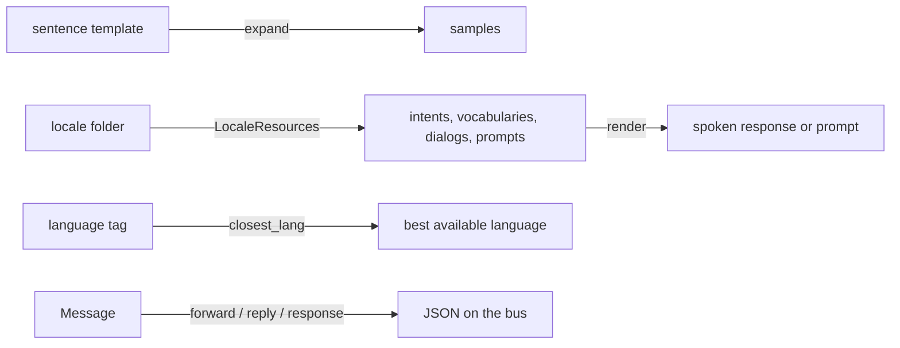

# ovos-spec-tools documentation
<!-- agent-hint
covers: the reading order of the ovos-spec-tools docs and the scope of the package
source: docs/*.md, ovos_spec_tools/__init__.py
generated: no
verify: python3 docs/check_page.py docs/index.md && for f in $(grep -o '([a-z-]*\.md)' docs/index.md | tr -d '()' | sort -u); do test -f docs/$f || exit 1; done
see: getting-started.md
-->

`ovos-spec-tools` gives one implementation of the primitives that the OVOS specifications describe, so that OVOS components and other tools do not each keep a copy.



## Quickstart

```bash
uv pip install --prerelease=allow ovos-spec-tools
```

```python
from ovos_spec_tools import expand

print(expand("(turn|switch) [the] light"))
```

```text
['turn the light', 'switch the light', 'turn light', 'switch light']
```

## Pages

Read the pages in order. The templates page is the base for the others.

| Page | What you get there |
| :--- | :--- |
| [getting-started.md](getting-started.md) | Install, and a first use of each tool |
| [templates.md](templates.md) | The template grammar: alternatives, optionals, slots, vocabulary references, malformed forms |
| [locale-resources.md](locale-resources.md) | The `locale/` folder, the file roles, and how to load them in each language |
| [dialog.md](dialog.md) | How to choose and fill a spoken response, and how to render a prompt |
| [language-matching.md](language-matching.md) | Tag standardization, distance and the closest match |
| [message.md](message.md) | The message envelope, `forward`, `reply`, `response`, and the session carrier |
| [sessions-and-context.md](sessions-and-context.md) | `Session` fields, `SessionManager`, and the intent context helpers |
| [bus-namespaces.md](bus-namespaces.md) | `SpecMessage`, the `MIGRATION_MAP` of legacy topics, and the bridge |
| [intents.md](intents.md) | Keyword intents with `IntentBuilder`, and `voc_match` |
| [linting.md](linting.md) | How to check a locale folder on the command line or in CI |
| [api-reference.md](api-reference.md) | Each public name, in brief |
| [spec-traceability.md](spec-traceability.md) | Each public name and the spec section that defines it |
| [migration.md](migration.md) | What changes for code that moves from the older helpers |

## Scope

The package expands, loads, renders, matches languages, lints and gives the message envelope. It does not recognize intents: an intent engine does that (OVOS-INTENT-1 §4). It does not carry messages: `ovos-bus-client` is the websocket transport, and HiveMind routes between devices.
